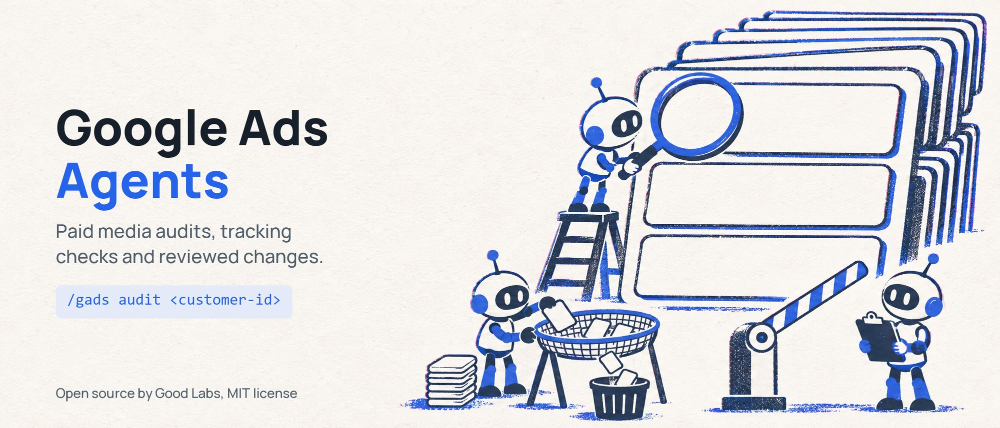
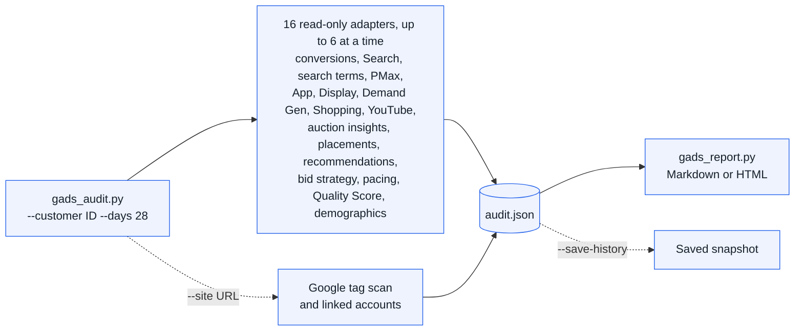
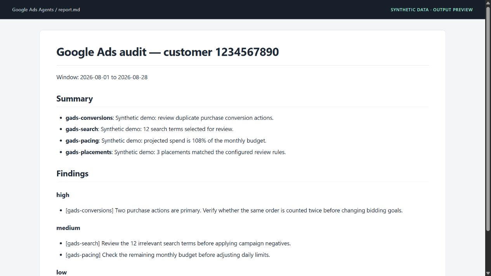

<p align="center">
  
</p>

# Google Ads Agents

Paid media audits, tracking checks and reviewed changes.

[](https://github.com/arcbaslow/google-ads-agents/actions/workflows/tests.yml)
[](https://github.com/arcbaslow/google-ads-agents/releases)
[](#installation)
[](LICENSE)

[Quick start](#quick-start) | [How an audit runs](#how-an-audit-runs) | [Example output](#example-output) | [MCP](#mcp) | [Tests](#tests) | [Contributing](CONTRIBUTING.md)

A Python toolkit for investigating Google Ads accounts and preparing changes for review. Use individual adapters from a terminal, or use the specialist agents and `/gads` skills in an agent runtime. API responses are structured JSON; the audit driver combines them into reports.

## What you can do

| Area | Included capabilities |
| --- | --- |
| Campaigns | Search, Performance Max, App, Display, Demand Gen, Shopping and YouTube analysis |
| Measurement | Conversion-action health and Google tag checks |
| Optimization | Search-term mining, negative candidates, recommendations with a brand hold, Quality Score and bid-strategy fit |
| Delivery | Budget pacing, anomalies, placement classification, demographic and geographic breakdowns |
| Assets | RSA strength, PMax linked asset inventory, creative briefs and asset workflows |
| Account operations | Per-MCC auth profiles, saved audit history and multi-account audits |
| Reviewed changes | PAUSED Search, Demand Gen and App campaigns, App targets, negatives, placements, Display targeting, image and YouTube video assets, and Video/Display ad edits with JSON review, confirmation and validation |

## How an audit runs



No adapter waits on another, so one failed read does not stop the rest. Read the conversion findings and the tag-scan limits first; bidding, pacing and search-term results depend on them.

## Installation

Requires **Python 3.10+**. Live queries also require Google Ads account access, an approved OAuth Cloud project, and Google Cloud SDK (`gcloud`) for the default authentication path.

```bash
git clone https://github.com/arcbaslow/google-ads-agents.git
cd google-ads-agents
python -m venv .venv
```

Activate the environment with `source .venv/bin/activate` on macOS/Linux or `.venv\Scripts\Activate.ps1` in Windows PowerShell. Then:

```bash
python -m pip install -e ".[dev]"
```

Prefer uv? Run `uv venv`, `uv pip install -e ".[dev]"`, then prefix Python commands with `uv run`.

## Quick start

First print and run the Google sign-in command, then register a manager-account profile:

```bash
python scripts/gads_auth.py --adc
# Run the gcloud command printed above, then configure your profile:
python scripts/gads_auth.py --add-profile demo --login-customer-id YOUR_MCC_ID
python scripts/gads_auth.py --use-profile demo
python scripts/gads_auth.py --check
python scripts/gads_auth.py --customers
```

Replace the example customer ID below with an account returned by `--customers`:

```bash
python scripts/gads_audit.py --customer 1234567890 --days 28 --output audit.json
python scripts/gads_report.py --input audit.json --format md --output audit.md
```

Add `--site https://example.com` to include the website tag check, and `--save-history` to retain a snapshot. The local session expires after 24 hours. For multiple MCCs, add profiles and switch with `--use-profile`. For an OAuth-client fallback, see [setup](docs/SETUP.md).

Developer tokens are optional legacy configuration. API access belongs to the OAuth Cloud project; see [setup](docs/SETUP.md) for approval and authentication instructions.

## Example output



The screenshot shows the actual Markdown report, rendered for documentation, using **synthetic data**. Reproduce it locally without Google credentials:

```bash
python scripts/gads_report.py --input examples/demo/audit.json --format md --output audit.md
python scripts/gads_report.py --input examples/demo/audit.json --format html --output audit.html
```

Read the [generated report](examples/demo/report.md) or inspect the [input fixture](examples/demo/audit.json).

## Everyday commands

```bash
python scripts/gads_search.py --customer 1234567890 --days 28 --negative-candidates --json
python scripts/gads_demandgen.py --customer 1234567890 --days 28 --json
python scripts/gads_placements.py --customer 1234567890 --days 28 --json
python scripts/gads_recommendations.py --customer 1234567890 --json
python scripts/gads_anomalies.py --customer 1234567890 --days 30 --baseline-days 14 --z 2.0 --json
python scripts/gads_history.py --customer 1234567890 --changes --days 7 --json
python scripts/gads_audit.py --all-customers --days 28 --save-history --output audits.json
```

Use `--help` on an adapter for its complete flags. Most read commands print a compact summary; `--json` selects machine-readable output. The audit driver always emits JSON.

Read-only GAQL and saved multi-account audit exports are documented in [REPORTING.md](docs/REPORTING.md); local monitoring output does not refresh credentials or schedule new account reads. See [read-only interoperability](docs/INTEROPERABILITY.md) for query and export handoffs, and [offline evaluation](docs/EVALUATION.md) for safety task fixtures.

### Agent workflow

The [router](skills/gads/SKILL.md) exposes commands such as:

```text
/gads audit 1234567890
/gads search 1234567890
/gads pmax 1234567890
/gads conversions 1234567890
/gads pacing 1234567890
/gads quality 1234567890
```

The repository includes [plugin metadata](.claude-plugin/plugin.json), specialist [agent definitions](agents/) and [skills](skills/). Other runtimes can follow [AGENTS.md](AGENTS.md) and call the same Python adapters. The audit skill runs the standalone driver, then interprets conversion checks and tag-scan limitations before wider analysis. Raw adapter outputs differ; failed blocks and missing fields are not a clean bill of health.

### Changes to an account

Supported write commands print the operation JSON to stderr and require an explicit `y` at a `y/N` prompt. `--apply` validates the same operations before applying them; `--validate-only` stops after validation. The flags are mutually exclusive. Piped stdin, EOF or unavailable input cancels the request.

```bash
# Produce a campaign planning draft without calling the API.
python scripts/gads_creation.py --customer 1234567890 --context-file context.json --json

# Validate proposed negatives without applying them.
python scripts/gads_apply.py --customer 1234567890 negatives --input negatives.json --validate-only --json
```

Campaign context produces a planning draft and does not verify measurement health. Separate strict `--search-spec`, `--demand-gen-spec` and `--app-spec` files create PAUSED campaigns atomically after review and validation; Video campaigns cannot be created through the API. See [bounded writes](docs/WRITES.md) for the required fields and limits.

### Optional hooks and sign-in service

The [hooks guide](docs/HOOKS.md) covers the session-expiry guard and opt-in Telegram notifications. The separate FastAPI service in [webapp/](webapp/) supports hosted sign-in; it is not required to run local audits.

## MCP

[`scripts/gads_mcp.py`](scripts/gads_mcp.py) exposes ten read-only tools to an MCP client, plus six gated write tools for a host. Run it as a standalone stdio server (read tools only), or import it in a host FastMCP server and call `register(server, prefix="", provider_factory=None)` and `register_writes(server, gate, prefix="", provider_factory=None)`, which return the number of tools added.

```bash
python -m pip install -e ".[mcp]"
gads-mcp
```

| Tool | Returns | `limit` default / max |
| --- | --- | --- |
| `list_accounts` | Accounts under the profile's manager account: ID, name, level, currency, time zone and status. Without a manager account, the customer IDs the credentials can access directly. | 200 / 500 |
| `run_gaql` | Rows for one GAQL `SELECT` against a customer ID. Only a single statement is accepted, optionally ending in one `LIMIT n`, without `PARAMETERS`, comments or semicolons. Rows are bounded by the smaller of that `LIMIT` and `limit`. | 100 / 500 |
| `resource_metadata` | GAQL resources, or the fields under a resource or prefix, with selectable, filterable and sortable flags. `detail=true` adds enum values and the resources, metrics and segments a name can be selected with. | 200 / 500 |
| `account_audit` | Status and summary of every read-only audit agent, plus the top findings by severity. Raw agent data, the website tag scan and saved snapshots are not included. | 50 / 200 |
| `anomalies_and_pacing` | Day-level metric anomalies and month-to-date budget pacing, together or separately. | 50 / 200 per list |
| `change_history` | Recent `change_event` entries over up to 30 days. Actor emails are reduced to their domain. | 50 / 200 |
| `keywords` | Keyword criteria (not negatives) with criterion ID, ad group ID, campaign ID, text, match type and status. Filters: campaign, ad group, status (default all but `REMOVED`). | 200 / 500 |
| `ads` | Ads with ad ID, ad group ID, campaign ID, type, status, policy approval status and final URLs. Same filters as `keywords`. | 200 / 500 |
| `search_terms` | Search terms between two dates, highest cost first: term status, campaign and ad group IDs, matched keyword text, match type and criterion ID, cost, clicks, impressions, conversions. The matched keyword's own status is not in this report; look it up with `keywords`. | 200 / 500 |
| `asset_group_assets` | Performance Max asset group links: field type, asset ID, type, name or text, link status and primary status. API v25 has no asset performance label. | 200 / 500 |

Every tool registered by `register` is annotated read-only. These tools call only `GoogleAdsService` search, `CustomerService.ListAccessibleCustomers` and `GoogleAdsFieldService` search. They do not write to an account, save audit snapshots, send notifications or change local credential files. Bounded results include `rows_returned` and `complete`; `complete: false` means rows were cut by `limit`, or an audit agent failed. Failures return `{"error": "<category>", "hint": "..."}`, where the category is `auth_required`, `permission_denied`, `quota_exceeded`, `invalid_argument`, `not_found` or `upstream_error`. Provider error messages are not passed through.

**Write tools.** `register_writes` adds these tools. Each takes `confirm` and `profile`.

| Tool | Changes | Mutate |
| --- | --- | --- |
| `set_keyword_status` | Up to 200 keywords of one ad group to `ENABLED` or `PAUSED` (`ad_group_criterion.status`). | `AdGroupCriterionService` |
| `set_ad_status` | Up to 200 ads of one ad group to `ENABLED` or `PAUSED` (`ad_group_ad.status`). | `AdGroupAdService` |
| `update_campaign_schedule` | Campaign `end_date_time` (`YYYY-MM-DD 23:59:59`) and, before the campaign starts, `start_date_time` (`YYYY-MM-DD 00:00:00`). | `CampaignService` |
| `set_conversion_action_goal` | `conversion_action.primary_for_goal`: primary or secondary for its goal. | `ConversionActionService` |
| `add_placement_exclusions` | Up to 200 campaign-level negative placement, YouTube channel, YouTube video and mobile app criteria, all or none. | `CampaignCriterionService` |
| `update_asset_group_assets` | Links existing assets to a Performance Max asset group and unlinks others, unlinks first, all or none. No upload. Annotated destructive. | `AssetGroupAssetService` |

A call without `confirm` changes nothing: it reads the targets, sends the operations with `validate_only`, and returns current and new values with a single-use `confirm` token valid for 10 minutes. The identical call with that token calls the host's `gate()`, then sends the same operations once, with a 60-second deadline and no automatic retry. Different arguments or a used token return `invalid_argument`; targets that changed since the dry run return `conflict`; in both cases nothing is sent. A gate refusal is returned unchanged and keeps the token. A Google Ads rejection returns `errors` with only the API's error codes and field paths. A timeout or server error on a confirmed write says the change may have been applied; read before trying again. Video campaigns return `not_supported`, since the API rejects every change to them. Each confirmed write logs one line: `gads write <tool> <resource> outcome=<ok|category>`. The OAuth scope is the same `adwords` scope the read tools use; the Google Ads user needs Standard or Admin access to the account.

**Authentication.** Every tool accepts `profile`. The standalone server uses the active local profile from `gads_auth.py`, including the 24-hour session cap. It never switches profiles: naming a different profile returns `invalid_argument` with the `--use-profile` command to run locally. A host can pass `provider_factory(profile)`, which returns a `gads_provider.CredentialProvider`, to supply its own per-profile credentials. A developer token is optional. `credentials_present()` reports whether a local credentials file, a `GOOGLE_APPLICATION_CREDENTIALS` file or the gcloud application-default credentials file exists. It does not open these files or make a network call.

**Quotas.** Each request counts against the Google Ads API quota of the OAuth Cloud project. `account_audit` sends 20 search requests, plus one search-terms request when `scripts/brand_rules.json` has brand terms for the customer (cached 15 minutes). The other tools send one request, or two for `anomalies_and_pacing` with `check="both"`, plus that same search-terms request for pacing when brand terms are configured. When the API reports a quota or rate limit, the tool returns `quota_exceeded`; retry later or narrow the request.

## Tests

```bash
python -m pytest scripts/ -q
python -m ruff check scripts/ hooks/ webapp/

# Optional hosted sign-in service: install its dependencies, then test it.
python -m pip install -r webapp/requirements.txt
python -m pytest webapp/tests/ -q
```

The suites use mocks and temporary credential stores. They cover auth profiles and expiry, GAQL, placement rules, campaign validation, report rendering, audit history, optimization heuristics, hooks, OAuth, sessions and the web API. No live Google Ads account is needed. CI runs the adapter and webapp suites on Python 3.10–3.13; see the [verification record](docs/VERIFICATION.md) for the release run.

## Repository map

| Path | Purpose |
| --- | --- |
| [scripts/](scripts/) | API adapters, report rendering and unit tests |
| [agents/](agents/), [skills/](skills/) | Specialist instructions and `/gads` routing |
| [hooks/](hooks/) | Session guard and Telegram notifications |
| [webapp/](webapp/) | Optional hosted sign-in service and tests |
| [examples/demo/](examples/demo/) | Reproducible report with synthetic data |
| [docs/](docs/) | Setup, hooks, release and verification guides |

## Releases

**[v0.7.0](https://github.com/arcbaslow/google-ads-agents/releases/tag/v0.7.0)** - see the [release notes](docs/RELEASE_NOTES.md) for this release and the [changelog](CHANGELOG.md) for project history.

GitHub Releases include downloadable artifacts and checksums. Package-registry publication is a separate, opt-in workflow; a GitHub release does not imply that the same version is available on PyPI or npm. Maintainers can follow the [release guide](docs/RELEASING.md).

## Contributing

Read [CONTRIBUTING.md](CONTRIBUTING.md), run the checks above, and include a minimal reproduction for bugs. Report vulnerabilities through [SECURITY.md](SECURITY.md).

## Related tools

| Project | Use it for |
| --- | --- |
| [Google Analytics Agent](https://github.com/arcbaslow/google-analytics-agent) | GA4 data quality, funnels and property management. |
| [Search Console Agent](https://github.com/arcbaslow/google-search-console-agent) | Search performance, indexing and page experience. |
| [Meta Ads Agents](https://github.com/arcbaslow/meta-ads-agents) | Campaign performance, creative fatigue and event health. |
| [GTM Diff](https://github.com/arcbaslow/gtm-diff) | Review the changes in your Google Tag Manager exports. |
| [Figma Taxonomy Gen](https://github.com/arcbaslow/figma-taxonomy-gen) | Turn interactive designs into a reviewable tracking plan. |

Maintained by [Good Labs](https://goodlabs.kz) - measurement implementation, tracking plans and analytics audits.

## License

[MIT](LICENSE) © Dilshat Rakhimov. This is an independent project; it is not an official product of the platform vendors.
